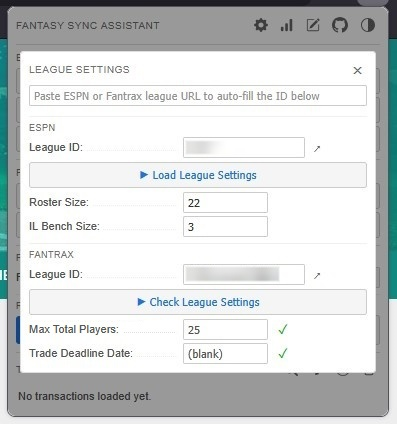
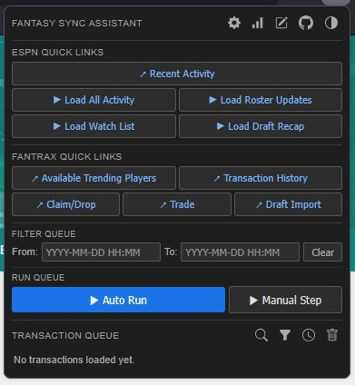
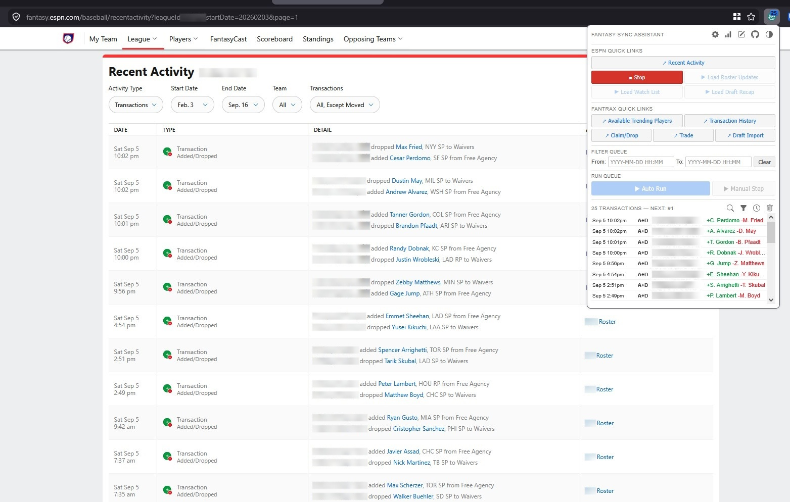
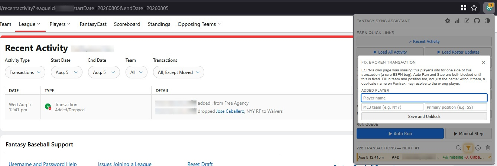
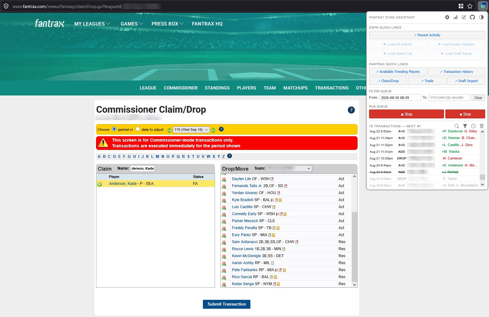
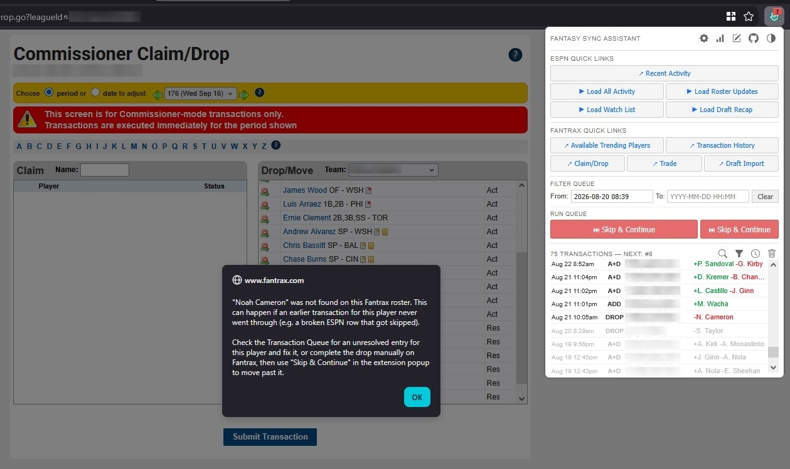
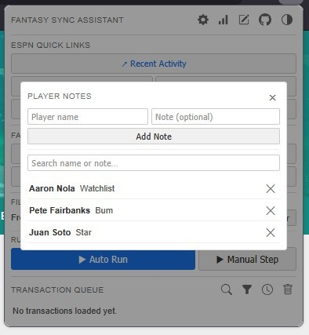
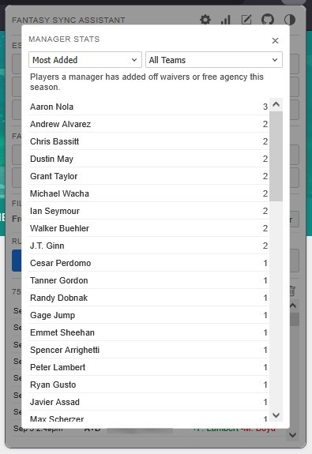
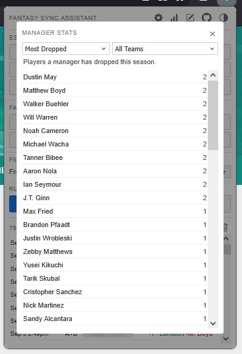
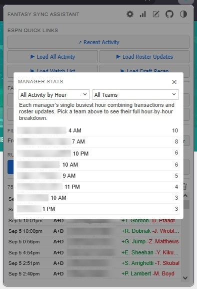

# Fantasy Sync Assistant Extension

[](https://addons.mozilla.org/en-US/firefox/addon/fantasy-sync-assistant/)
[](https://addons.mozilla.org/en-US/firefox/addon/fantasy-sync-assistant/)
[](https://addons.mozilla.org/en-US/firefox/addon/fantasy-sync-assistant/)
[](https://addons.mozilla.org/en-US/firefox/addon/fantasy-sync-assistant/)
[](https://github.com/wazam/fantasy-sync-extension/releases)

 **Fantasy Sync Assistant** is a Firefox extension for competitive fantasy baseball players who mirror their ESPN league on Fantrax. Fantrax's available trending players page becomes accurate only when your Fantrax rosters match ESPN exactly. This extension scrapes ESPN transactions and draft picks into a queue and replays each move on the Fantrax Commissioner pages, keeping your mirror up to date without manual re-entry.

## Table of Contents

- [Features](#features)
- [Tech Stack](#tech-stack)
- [Quick Start](#quick-start)
  - [Install from Firefox Add-ons](#install-from-firefox-add-ons)
  - [Build from Source](#build-from-source)
  - [Load from Source](#load-from-source)
- [Usage](#usage)
- [Screenshots](#screenshots)
- [Contributing](#contributing)
- [Disclaimers](#disclaimers)
- [License](#license)

## Features

- **Transaction Queue**: Scrapes transactions from ESPN Recent Activity and Draft Recap pages. Processed transactions are marked with strikethrough, and out-of-window transactions are shown in grey.
- **Exclude Transactions**: Ctrl+click any queue row to skip it during processing, and Ctrl+click again to restore it.
- **Queue Controls**: The search icon filters the queue by player name, the funnel icon filters to only broken transactions that need a fix, the clock icon opens a read-only history of everything already processed, and the trash icon clears the entire queue.
- **Filter Queue**: From / To datetime fields define the window of transactions to process. Click any queue row to set the lower bound instantly, drag across rows to set both bounds, or paste ESPN-format timestamps like "Mon Apr 6 6:19 am", which convert to the correct format.
- **Auto Run**: Processes the entire transaction queue automatically, navigating between Fantrax pages as needed. Click again while running to stop.
- **Manual Step**: Processes one transaction at a time, navigating to the right Fantrax page first if needed. Click again while Auto Run is active to stop it.
- **Fix Broken Transaction**: On the rare occasion ESPN's own page is missing a player's identity, the affected row is highlighted and a modal lets you fill in the name, MLB team, and position manually so the queue can continue.
- **Skip & Continue**: When Fantrax can't complete a transaction automatically (an ambiguous name match, a player not found, a trade deadline in the way, and similar cases), the extension shows exactly why and lets you finish it manually on Fantrax, then skip past it without reprocessing.
- **Transaction Types**: Handles adds, drops, trades, and draft picks, and searches for players by name with fallback variants for initials, accents, hyphens, and MLB team disambiguation.
- **Quick Links**: One-click buttons that use your saved league IDs to open the corresponding league page, walk every page of ESPN activity or roster updates, or import your ESPN Watch List into Player Notes.
- **League Settings Verification**: ESPN and Fantrax league IDs can be saved by pasting a full league URL or just the extracted ID. It checks Fantrax's Max Total Players against ESPN's roster + IL requirement and confirms the Trade Deadline Date is blank, since a set deadline blocks replaying trades from earlier in the season.
- **Roster Updates Tracking**: Indexes ESPN roster/lineup moves separately from adds, drops, and trades, without touching the transaction queue, purely to feed Manager Stats.
- **Manager Stats**: Most Dropped, Most Added, and Most Trades leaderboards, plus three "by Hour" breakdowns (transactions, roster updates, and both combined) showing when each manager is most active, all filterable by team.
- **Player Notes**: Freeform notes per player, independent of the transaction queue, searchable by name or note text, with one-click import from your ESPN Watch List.

## Tech Stack

- **Language and Runtime**: Plain JavaScript, with no frameworks and no build step beyond packaging.
- **Extension Platform**: A Firefox WebExtension (Manifest V2), with a background script, a toolbar popup, and content scripts for ESPN's and Fantrax's pages, keeping its data in the extension's local storage.
- **Tooling**: Node.js with Mozilla's web-ext, which lints the extension with the same checks Firefox Add-ons runs and packages it.
- **Distribution**: Firefox Add-ons, signed by Mozilla, with each GitHub release attaching the signed `.xpi` and the `.zip` submitted for it.

## Quick Start

> [!TIP]
> Install from Firefox Add-ons is recommended for most users. No clone required.

### Install from Firefox Add-ons

1. **Open the add-on's page**

   Visit [Fantasy Sync Assistant on Firefox Add-ons](https://addons.mozilla.org/en-US/firefox/addon/fantasy-sync-assistant/) in Firefox.

2. **Add it to Firefox**

   Select **Add to Firefox** and accept the permissions prompt. The extension appears in the toolbar.

### Build from Source

Standard Firefox requires all add-ons to be signed by Mozilla. Unsigned local builds can only be permanently installed on [Firefox Developer Edition](https://www.mozilla.org/en-US/firefox/developer/) or [Firefox Nightly](https://www.mozilla.org/en-US/firefox/channel/desktop/#nightly) with signature enforcement turned off.

1. **Install Firefox Developer Edition or Firefox Nightly**

2. **Allow unsigned add-ons**

   Open `about:config`, accept the warning, search for `xpinstall.signatures.required`, and set it to `false`.

3. **Clone the repository**

   ```sh
   git clone https://github.com/wazam/fantasy-sync-extension.git
   cd fantasy-sync-extension
   ```

4. **Build the extension**

   Install Node 26 LTS, then install the exact dependency versions from `package-lock.json` and build the extension package:

   ```sh
   npm ci
   npm run build
   ```

   This creates a `.zip` file in the `web-ext-artifacts/` folder.

5. **Install the build**

   In Firefox Developer Edition or Nightly, open `about:addons`, select the gear icon, choose **Install Add-on From File...**, and select the `.zip` file from `web-ext-artifacts/`. The extension appears in the toolbar and stays installed across restarts.

### Load from Source

Loads the extension directly from source without building. It works in any Firefox version, but Firefox removes it when it closes.

1. **Download or clone the repository**

2. **Load it in Firefox**

   Open `about:debugging#/runtime/this-firefox`, select **Load Temporary Add-on...**, and choose the `manifest.json` file in the repository folder. The extension appears in the toolbar right away.

## Usage

1. Click the gear icon to open League Settings and save your ESPN and Fantrax league IDs, or paste a full league URL to auto-fill each ID.
2. Open League Settings and click **Check League Settings** to confirm Fantrax's **Max Total Players** covers ESPN's roster + IL, and that no trade deadline is set to block replaying older trades.
3. Navigate to an ESPN Recent Activity or Draft Recap page, or click **Load All Activity**, to scrape transactions into the queue.
4. Optionally, set the From / To range under Filter Queue to narrow which transactions will be processed.
5. Click **Auto Run** to process the entire queue automatically, or **Manual Step** to process the next transaction one at a time. The extension navigates the active tab to the correct Fantrax Commissioner page (Claim/Drop, Trade, or Draft Import) on its own.

## Screenshots



League Settings modal with both ESPN and Fantrax league IDs saved, ESPN roster/IL sizes loaded, and Fantrax's Max Total Players and Trade Deadline Date both verified with green checkmarks.



Main popup in dark mode before any transactions are loaded, showing all ESPN and Fantrax Quick Links along with the cutoff filter and run controls.



Load All Activity walking ESPN's Recent Activity pages and indexing add/drop transactions into the Transaction Queue in real time.



The Fix Broken Transaction modal appears when ESPN's own Recent Activity page is missing a player's name, letting you fill in the name, MLB team, and position manually so the queue can continue.



Auto Run processing the Transaction Queue automatically on Fantrax's Commissioner Claim/Drop page, adding and dropping players to match ESPN.



When Fantrax can't complete a transaction automatically (here, a player missing from the roster), the extension surfaces the reason and switches to "Skip & Continue" so you can resolve it manually and move on without reprocessing anything.



Player Notes modal for jotting down personal reminders about specific players, like watchlist flags or scouting notes, searchable independent of the transaction queue.



Manager Stats' Most Added view, ranking every player by how many times they've been added off waivers or free agency across the league this season.



Manager Stats' Most Dropped view, the same idea in reverse: which players have been cut most often this season.



All Activity by Hour, showing each manager's single busiest hour combining transactions and roster updates, useful for spotting who's most active and when.

## Contributing

Report bugs or feature requests by opening an issue on the [GitHub repository](https://github.com/wazam/fantasy-sync-extension/issues). See [CHANGELOG.md](CHANGELOG.md) for what changed in each release, [ROADMAP.md](ROADMAP.md) for planned and proposed features, and [RELEASING.md](RELEASING.md) for how a release is made.

## Disclaimers

- [ESPN Terms of Use](https://disneytermsofuse.com/english/)
- [Fantrax Terms of Service](https://www.fantrax.com/terms-of-service)

## License

This project is licensed under the [MIT License](LICENSE).
